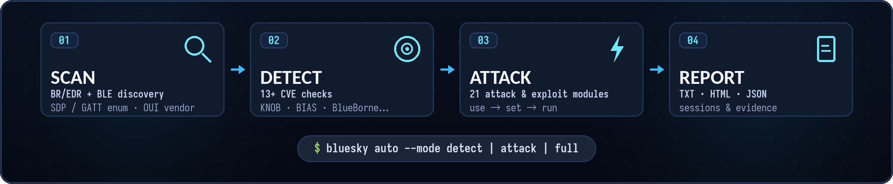
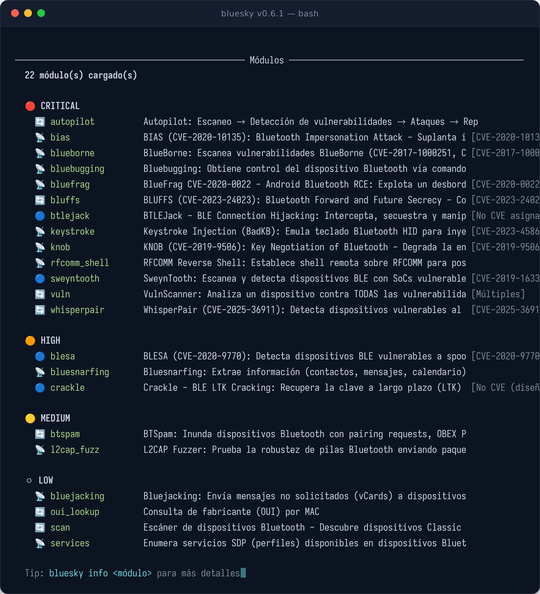
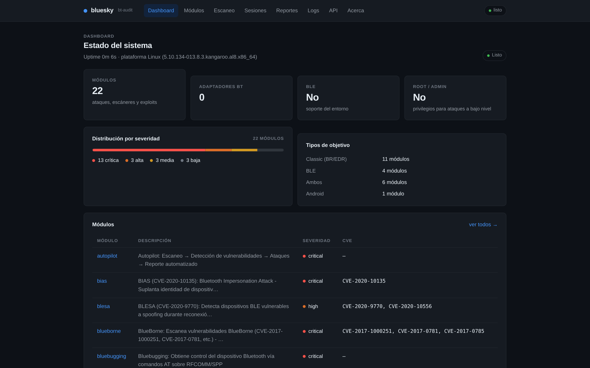
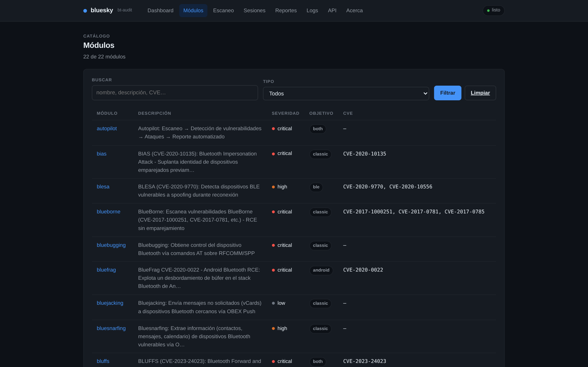

# bluesky

**A modular, Metasploit-style framework for auditing Bluetooth Classic (BR/EDR) and BLE devices.**

Discover nearby devices, enumerate their services, check them against a catalog of known
vulnerabilities, and run proof-of-concept modules following a familiar `use → set → run`
workflow — from the CLI, an interactive REPL, or a web dashboard. Every audit is recorded
into a session and can be exported as TXT, HTML, or JSON.

[](https://www.python.org/)
[](https://github.com/Ruby570bocadito/bluesky/actions)

[](#compatibility)
[](LICENSE)

> **Authorized use only.** Run bluesky exclusively against devices and networks you own or
> have explicit written permission to test. The authors accept no liability for misuse.

---

## Design principles

- **No fabricated results.** A module does only what the available hardware, tools, and
  permissions actually allow. When something is missing, it reports `success=false` and
  states exactly what is required — it never invents findings.
- **Real primitives.** Advanced modules delegate to reference tooling (`btlejack`,
  `hcidump`, `sdptool`, PyBluez) and BLE key cracking uses the real SMP algorithm
  (AES-128 via `cryptography`), not placeholders.
- **Offline by default.** The web dashboard and module catalog ship with no CDNs, no
  external fonts, and no outbound calls.
- **Defender-oriented.** Every module includes an educational mode explaining what it does,
  how it works step by step, its impact, and how to mitigate it.

## Workflow

Four phases, each feeding the next, all recorded into the session:

<p align="center">
  
</p>

The autopilot selects modules automatically from the vulnerabilities it detects
(`detect` reports only, `attack` chains modules against a target, `full` runs end to end).
Any module can still be run individually from the CLI, the REPL, or the dashboard.

## Features

- **3 scanners** — BR/EDR + BLE discovery, SDP service enumeration, and vulnerability
  analysis (13+ CVE-backed checks).
- **21 attack/exploit modules** — KNOB, BIAS, BLUFFS, BlueBorne, BlueFrag, BLESA,
  SweynTooth, WhisperPair, Crackle, BTLEJack, BlueSmack, keystroke injection, L2CAP
  fuzzing, and an RFCOMM shell.
- **REPL console** — contextual prompt, tab completion, favorites, and persistent sessions.
- **Scriptable CLI** — per-command help, consistent exit codes (`0`/`1`/`2`), `--json`
  output, `--no-color`, and a silent-by-default log with `--verbose`.
- **OUI vendor lookup** — every discovered device is annotated with its manufacturer from
  the MAC prefix, using an offline database.
- **Autopilot** — automated scan → detect → attack → report pipeline.
- **Exports** — CSV/JSON from the CLI (`bluesky scan --export devices.csv`) and one-click
  export from the web UI.
- **Plugin system** — drop a module into `plugins/`; `plugins/oui_lookup.py` is a working
  example.
- **Cross-platform** — Linux (BlueZ), Windows (WinRT/Bleak), Termux (Android), and WSL,
  with automatic backend detection.

## Installation

```bash
git clone https://github.com/Ruby570bocadito/bluesky.git
cd bluesky
pip install -r requirements.txt

# optional: install as a global command
pip install .
```

| Platform          | Install                                 |
|-------------------|-----------------------------------------|
| Linux / macOS     | `pip install -r requirements.txt`       |
| Termux (Android)  | `bash scripts/install_termux.sh`        |
| Windows           | `scripts/install_windows.ps1`           |
| Docker            | `docker-compose up`                     |

Some modules need extra tooling (documented in each module's `info`): `scapy` for active
attacks, `pybluez` for BlueFrag L2CAP sends, `cryptography` for Crackle (AES), the
`btlejack` tool for BLE hijacking, and `bluez-hcidump` for captures.

## Quick start

```bash
bluesky status                           # Bluetooth hardware status
bluesky scan --ble --export devices.csv  # scan and export to CSV
bluesky vuln AA:BB:CC:DD:EE:FF           # vulnerability analysis (13+ checks)
bluesky attack bluejacking AA:BB:CC:DD:EE:FF
bluesky auto --mode detect               # automated pipeline
bluesky console                          # interactive REPL
bluesky web --port 5000 --open           # web dashboard
```

Global options: `--config <file>` · `--json` · `--no-color` · `-v/--verbose` · `--version`.
Exit codes: `0` OK · `1` execution error · `2` usage error. Every command ships its own
help (`bluesky scan --help`).

## CLI reference

| Command | Description |
|---------|-------------|
| `scan [--ble\|--classic] [--export F]` | Scan nearby devices (with OUI vendor lookup) |
| `services <MAC>` | Enumerate SDP services |
| `vuln <MAC> [--options JSON]` | Vulnerability analysis (13+ checks) |
| `attack <module> [MAC]` | Run a module from the catalog |
| `auto [MAC] [--mode detect\|attack\|full]` | 4-phase autopilot |
| `spam <MAC\|all> [--method M] [--rate N]` | BTSpam flooding (3 techniques) |
| `list` / `info <module>` | Module catalog and details |
| `educate [module]` | Educational mode |
| `status` | Adapter, capabilities, and backends |
| `session list\|save\|load\|summary` | Session management |
| `report [--html\|--json\|--txt] [-o FILE]` | Session report |
| `config` / `plugin` / `web` / `console` | Configuration, plugins, dashboard, REPL |

## Module catalog

| Module | Type | Target | Description |
|--------|------|--------|-------------|
| `scanner/device_scanner` | Scanner | BR/EDR + BLE | Device discovery |
| `scanner/service_scanner` | Scanner | SDP | Service enumeration |
| `scanner/vuln` | Scanner | All | 13+ vulnerability checks |
| `attack/knob` | Attack | BR/EDR | Entropy downgrade (CVE-2019-9506) |
| `attack/bias` | Attack | BR/EDR | Identity impersonation (CVE-2020-10135) |
| `attack/bluffs` | Attack | BR/EDR | Forward/future secrecy (CVE-2023-24023) |
| `attack/blueborne` | Attack | BR/EDR | RCE via the BT stack (CVE-2017-0781) |
| `attack/bluefrag` | Attack | BLE | Android RCE (CVE-2020-0022) |
| `attack/blesa` | Attack | BLE | Insecure connection re-establishment |
| `attack/bluejacking` | Attack | Generic | Unsolicited OBEX push |
| `attack/bluesnarfing` | Attack | Generic | OBEX data extraction |
| `attack/bluebugging` | Attack | Generic | AT command injection |
| `attack/sweyntooth` | Attack | BLE | DoS/RCE suite (6 CVEs) |
| `attack/whisperpair` | Attack | BLE | Fast Pair pairing bypass |
| `attack/crackle` | Attack | BLE | LTK/STK recovery (real SMP, AES-128) |
| `attack/btlejack` | Attack | BLE | Hijacking/sniffing (delegates to btlejack) |
| `attack/btspam` | Attack | Generic | Flooding (3 techniques) |
| `attack/autopilot` | Auxiliary | All | Automated audit pipeline |
| `exploit/keystroke_injection` | Exploit | HID | Keystroke injection |
| `exploit/l2cap_fuzz` | Exploit | L2CAP | Protocol fuzzing |
| `exploit/rfcomm_shell` | Exploit | RFCOMM | Interactive shell |
| `oui_lookup` *(plugin)* | Utility | MAC | Vendor by OUI (offline) |

`bluesky list` groups the catalog by severity; `bluesky info <module>` shows CVEs, required
hardware, and usage.

<p align="center">
  
</p>

## Educational mode

Every module documents **what it is, how it works step by step, its impact, and how to
mitigate it**, with a focus on the defender:

```bash
bluesky educate          # index of contents
bluesky educate knob     # KNOB (CVE-2019-9506) explained
bluesky> educate bias    # from the REPL console
```

Also available in the web UI under **Modules → knob → Educational mode**. Full catalog
coverage (22 modules).

## Web dashboard

A minimalist dark-mode UI, fully offline, with safe rendering (`textContent`), CSRF
protection on mutating endpoints, optional token authentication, and path-traversal
protection on the reports API.

```bash
bluesky web --port 5000 --open
# expose on the network with authentication:
bluesky web --host 0.0.0.0 --token "$(openssl rand -hex 16)"
```

<p align="center">
  
  
</p>

- **Live dashboard** — module stats, severity distribution, and target types.
- **Module catalog** — filter by name/type, with details, options, CVEs, and references.
- **Live scan** — inquiry/BLE or SDP/GATT enumeration from the browser, exportable to CSV.
- **Sessions, reports, and logs** — built-in viewers with safe rendering.

## Compatibility

| Platform | Status | Notes |
|----------|--------|-------|
| Linux (BlueZ) | Full | `hcitool`, `gatttool`, `hcidump`; CSR dongles supported |
| Windows | Full | Native backend via WinRT/Bleak |
| Termux (Android) | Full | `termux-bluetooth` backend |
| WSL | Limited | No direct USB Bluetooth access |

## Testing

```bash
python -m pytest tests/ -q     # 424 tests, 100% offline
```

The suite is fully offline: no hardware, no network, and no real devices are touched —
backends and system tools are mocked. CI runs on GitHub Actions (full suite plus `ruff`
linting on every push). Regression coverage lives in `tests/test_qa_*.py` and
`tests/test_security_bugs.py` (path traversal, XSS, CSRF, module contracts, result
serialization).

## Project structure

```text
bluesky/
├── bluesky/
│   ├── core/          # engine, sessions, hardware, reporter, education
│   ├── modules/       # scanners/ · attacks/ · exploits/
│   ├── utils/         # config, OUI, CSV, platform backends
│   └── web/           # Flask dashboard (app + templates + static)
├── plugins/           # oui_lookup.py: sample plugin
├── scripts/           # installers (Linux/Windows/Termux), build, completions
├── tests/             # 424 offline tests
└── docs/
    ├── assets/        # screenshots and the pipeline diagram
    └── ANALISIS_BLUETOOTH.md   # technical deep-dive: top 10 BT attacks (Spanish)
```

## Learn more

- [Deep-dive: Top 10 Bluetooth attacks](docs/ANALISIS_BLUETOOTH.md) — the technical
  foundation behind the module catalog *(in Spanish)*.

## License

Released under the [MIT License](LICENSE).
